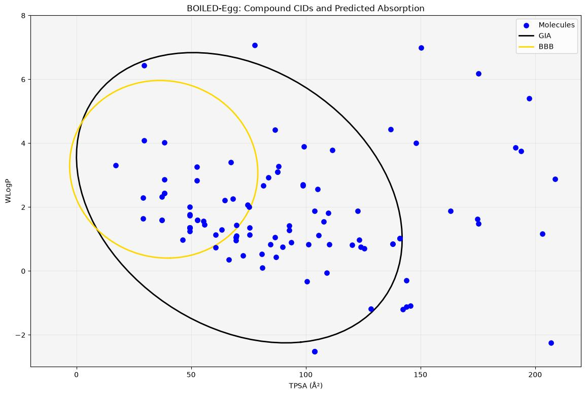

# BOILED-Egg Web

A Flask web app that predicts **gastrointestinal (GI) absorption** and **blood-brain barrier (BBB) penetration** of small molecules using the BOILED-Egg model. Upload one or more `.sdf` files, and the app calculates TPSA and WLogP for every molecule, classifies it against the GIA and BBB regions, and shows the results as a plot and a table.

> **Scope note:** this tool predicts absorption and brain penetration from two descriptors. It is a quick screening aid for early-stage work (for example, shortlisting candidates in a drug repurposing workflow), not a drug repurposing engine by itself.

## Attribution

This project is a modified version of **pyBOILEDegg** by Bruce F. Milne (Copyright 2021, GPL v3): https://doi.org/10.5281/zenodo.4725530

The BOILED-Egg model and the GIA/BBB ellipse coordinates come from Daina & Zoete (2016).

### What I changed

- Added a Flask web interface with multi-file `.sdf` upload
- Results displayed in the browser: scatter plot with GIA/BBB regions plus a results table
- PDF and CSV download for each run
- Per-run output folders, filename sanitising, and reporting of molecules that fail to parse (instead of silently skipping them)

### What is from the original

- The descriptor calculation approach (TPSA with S and P included, WLogP via RDKit)
- The GIA and BBB ellipse coordinates and the point-in-polygon classification logic

## How it works

1. **TPSA** is calculated with RDKit (`Descriptors.TPSA`, including sulfur and phosphorus contributions).
2. **WLogP** (Wildman-Crippen LogP) is calculated with RDKit (`Descriptors.MolLogP`).
3. Each molecule becomes a point (TPSA, WLogP). Using Shapely, the app checks whether the point falls inside the GIA polygon (the "white") or the BBB polygon (the "yolk").


## Installation

```bash
git clone https://github.com/rishavranjan808/Drug_Repurposing_Project-ProDrug-.git
cd Drug_Repurposing_Project-ProDrug-
python -m venv .venv
source .venv/bin/activate        # Windows: .venv\Scripts\activate
pip install -r requirements.txt
```

RDKit installs from pip as `rdkit`. If that fails on your system, install it with conda instead (`conda install -c conda-forge rdkit`).


## Usage
streamlit run frontend.py

Open http://localhost:3000, upload one or more `.sdf` files, and view the results.

### Input

`.sdf` files containing one or more molecules. Molecule names are read from the SDF title line. If a molecule has no name, it is labelled `filename#position`.

### Output

| Output | Where |
|---|---|
| Scatter plot with GIA/BBB regions | Shown in the browser |
| Results table (Name, Source file, TPSA, WLogP, GIA, BBB) | Shown in the browser |
| Image of the plot | Download button on the results page |
| CSV of the results | Download button on the results page |

Files that are not `.sdf`, and molecules RDKit cannot parse, are listed on the results page.


## Screenshots




## Limitations

- The model uses only TPSA and WLogP, so it is an approximation and does not replace experimental data or more detailed ADME models.
- Predictions are only as good as the input structures.
- Intended for local use. If you deploy it publicly, add authentication and cleanup of old results.

## License

This project is licensed under the **GNU General Public License v3.0**, the same license as the original pyBOILEDegg. See [LICENSE](LICENSE).

## References

1. Daina, A. & Zoete, V. A BOILED-Egg To Predict Gastrointestinal Absorption and Brain Penetration of Small Molecules. *ChemMedChem* **11**, 1117-1121 (2016).
2. Milne, B. F. bfmilne/pyBOILEDegg, version 1.0.0. Zenodo (2021). https://doi.org/10.5281/zenodo.4725530
